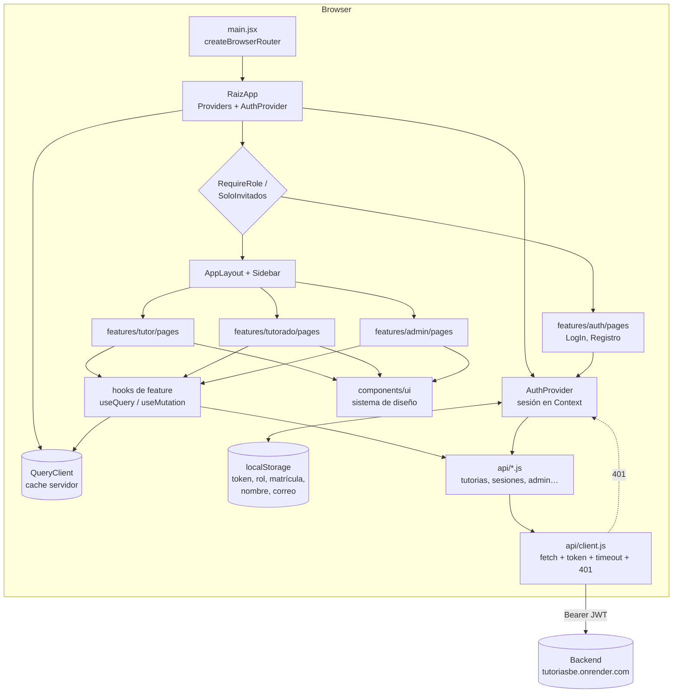

# Auditoría técnica del frontend: Sistema de Tutorías

Fecha: 2026-10-09 · Rama auditada: `feat/nuevo-modelo` (con 35 archivos modificados sin commit) · Auditor: revisión estática y comandos de solo lectura.

## Resumen ejecutivo

**Estado general:** el código es pequeño (~11.400 líneas con tests), está bien organizado por _features_ y tiene buena disciplina técnica: lint y Prettier sin errores, build limpio y 177 tests en verde con un 92,6 % de cobertura de sentencias. Los problemas no están en la calidad del código sino en todo lo que rodea al despliegue: endurecimiento del hosting, observabilidad, dependencias vulnerables y garantías que dependen del backend.

**Los 3 riesgos más graves:**

1. **JWT en `localStorage` sin CSP ni cabeceras de seguridad** (`render.yaml`): cualquier XSS, propio o de una dependencia, permite robar la sesión.
2. **Autorización que depende de un backend que no se puede verificar desde aquí:** cualquiera puede registrarse como `TUTOR` desde el cliente y el rol que pinta la UI se lee de `localStorage` y se puede manipular.
3. **Sin monitorización de errores en producción, y un despliegue que no espera a la CI**, con `react-router-dom` (prod) y `vite` (dev) en versiones con advisories _high_.

**Notas (1–10):** Arquitectura 8 · Componentes 7 · Seguridad 5 · Rendimiento 7 · Accesibilidad 6 · Calidad de código 8 · Dependencias 6 · UX/compatibilidad 7 · Build y despliegue 5.

**¿Listo para producción?** Todavía no. Funcionalmente parece completo para los tres roles, pero antes de abrirlo a usuarios reales hay que actualizar dependencias, añadir cabeceras/CSP, poner monitorización de errores, hacer commit del trabajo pendiente y confirmar con el backend las reglas de autorización (sobre todo el autorregistro como tutor). Es aproximadamente una semana de trabajo, no una reescritura.

---

## Comandos ejecutados

| Comando                                | Resultado                                                                                                               |
| -------------------------------------- | ----------------------------------------------------------------------------------------------------------------------- |
| `node -v` / `npm -v`                   | v22.21.0 / 11.17.0 (cumple `engines >=22.12`)                                                                           |
| `npx eslint .`                         | **0 errores, 0 avisos**                                                                                                 |
| `npx prettier --check .`               | Todo formateado                                                                                                         |
| `npx vite build`                       | OK en 1,8 s, **sin avisos**, sin `.map` en `dist/`                                                                      |
| `npx vitest run --coverage`            | **17 archivos, 177 tests, todos pasan** (64 s). Stmts 92,56 % · Branches 75,68 % · Funcs 92 % · Lines 94,2 %            |
| `npm audit`                            | 12 vulnerabilidades (2 críticas, 7 altas, 1 moderada, 2 bajas); **solo 1 paquete afecta a producción** (`react-router`) |
| `npm outdated`                         | 20 paquetes con versiones nuevas (casi todas minor/patch)                                                               |
| Escaneo de licencias en `node_modules` | Sin GPL/AGPL; solo MIT/ISC/Apache/BSD, OFL-1.1 (fuente) y MPL-2.0 (herramientas de build)                               |

Nota: el build y la cobertura regeneraron `dist/` (que ya existía y está en `.gitignore`). La cobertura se escribió en un directorio temporal. No se modificó ningún archivo versionado.

---

## 1. Visión general

### Propósito (según el código)

Es una SPA para gestionar tutorías académicas de una facultad, con tres roles (`src/constants/roles.js`):

- **Tutorado:** explora tutorías con filtros por día, cupo y choques de horario; se inscribe o se da de baja; consulta su asistencia, su semana y su riesgo de baja automática por inasistencias; deja comentarios en la tutoría.
- **Tutor:** crea y edita tutorías (Experiencia Educativa, edificio, aula, horarios con temas), ve las sesiones de hoy, abre y cancela sesiones, pasa lista con guardado inmediato, cierra la lista (lo que aplica bajas automáticas) y consulta el historial de asistencia en forma de matriz.
- **Admin:** ve las tutorías de la facultad con indicadores, las desactiva, cierra el periodo (desactiva todas) y gestiona el catálogo de Experiencias Educativas.

### Stack exacto (instalado)

| Área                     | Tecnología                                                                                       |
| ------------------------ | ------------------------------------------------------------------------------------------------ |
| UI                       | React 19.2.5 / react-dom 19.2.5                                                                  |
| Build                    | Vite 8.0.10 + @vitejs/plugin-react 6.0.1                                                         |
| Lenguaje                 | **JavaScript (JSX)**, sin TypeScript (`jsconfig.json` con `checkJs: false`)                      |
| Router                   | react-router-dom 7.15.0, _data router_ (`createBrowserRouter`, `lazy`)                           |
| Estado de servidor       | @tanstack/react-query 5.103.1                                                                    |
| Estado global de cliente | React Context (solo la sesión: `AuthProvider`)                                                   |
| Formularios / validación | react-hook-form 7.88 + zod 4.6.5 + @hookform/resolvers 5.9                                       |
| Estilos                  | CSS Modules + CSS global con tokens (`src/styles/tokens.css`), fuente Montserrat (fontsource)    |
| Notificaciones           | sonner 2.0.8                                                                                     |
| HTTP                     | `fetch` envuelto en `src/api/client.js`                                                          |
| Testing                  | Vitest 5, Testing Library, MSW 2, jsdom 28                                                       |
| Calidad                  | ESLint 10 (react-hooks, react-refresh, jsx-a11y-x), Prettier 3, Husky + lint-staged + commitlint |
| Hosting                  | Render Static Site (`render.yaml`)                                                               |

### Estructura de carpetas

| Carpeta                  | Responsabilidad                                                                                                               |
| ------------------------ | ----------------------------------------------------------------------------------------------------------------------------- |
| `src/app`                | Arranque, router, proveedores, QueryClient, páginas de error y 404                                                            |
| `src/api`                | Cliente HTTP, un módulo por recurso del backend y `queryKeys.js`                                                              |
| `src/components/ui`      | Sistema de diseño base (Button, Input, Modal, Card, Badge, Alert, Skeleton…)                                                  |
| `src/components/layout`  | Shell autenticado (AppLayout, Sidebar, Pagina)                                                                                |
| `src/features/<dominio>` | `auth`, `tutor`, `tutorado`, `admin`, `tutorias` (compartido), `comentarios`; cada una con `pages/`, `components/` y `hooks/` |
| `src/schemas`            | Esquemas zod de formularios                                                                                                   |
| `src/constants`          | Rutas, roles, horarios, estados                                                                                               |
| `src/utils`              | Formateo, fechas, cupo, choques de horario, helpers de mutación y avisos                                                      |
| `src/test`               | Setup, servidor MSW, fixtures y helpers de render                                                                             |

### Estado de avance

- **Terminado:** login/registro, los tres paneles con todas las rutas del router, el pase de lista con cierre, el historial y la gestión del catálogo. Todas las rutas tienen página real con tests; no encontré pantallas vacías ni _stubs_.
- **Incompleto o en curso:** la rama tiene **35 archivos modificados sin commit** (+624/−1005), que eliminan el login con Google/Microsoft (`redirect.html`, `src/app/redirect.js`, `proveedores/*`). El trabajo funciona (los tests pasan sobre el árbol actual), pero no está versionado.
- **No existe:** recuperación de contraseña, verificación de correo, edición de perfil, paginación en los listados de admin.

---

## 2. Arquitectura

**Organización real:** _feature-based_ con una capa compartida (`components/ui`, `api`, `utils`). Se aplica de forma consistente. El dominio compartido entre roles vive en `features/tutorias` y no se duplica en `tutor/` ni en `tutorado/`.

**Separación de capas:** buena. Las páginas consumen _hooks_ de feature (`useDetalleTutor`, `usePaseDeLista`…), los hooks encapsulan React Query y los módulos de `api/` solo construyen peticiones. Las páginas no llaman a `fetch` directamente.

**Capa de API** (`src/api/client.js`):

- ✅ Centralizada: URL base, token inyectado (`configureApi`), timeout de 15 s, cancelación con `AbortSignal` (React Query pasa `signal` en todas las queries), mensajes de error normalizados (`ApiError` con `status`, `data` y `errores` por campo) y gestión del 401.
- ✅ Reintentos: las queries reintentan 1 vez salvo en 4xx (`app/queryClient.js:4-8`); las mutaciones no reintentan (es lo correcto).
- ❌ **Sin tipado ni validación de respuestas:** `return cuerpo?.data ?? null` (`client.js:120`). La forma de los datos solo está documentada en comentarios y no es uniforme (ver H-10).

**Estado:** el estado de servidor está en React Query con claves centralizadas en `queryKeys.js` y la invalidación se hace por raíz de dominio. El estado global de cliente se limita a la sesión. Los filtros viven en la URL (`useSearchParams`). No hay _prop drilling_ relevante. Hay estado duplicado en `Comentarios.jsx` (`enviando`, `eliminandoId` replican `isPending` de las mutaciones) y en `tutorado/pages/Home.jsx:46` (`busqueda` es una copia de `q` que no se resincroniza al navegar atrás).

**Enrutamiento** (`app/router.jsx`): rutas protegidas por rol (`RequireRole`), solo invitados (`SoloInvitados`), lazy loading de **todas** las páginas, `errorElement` en la raíz y por layout, 404 (`*`), redirecciones desde URLs antiguas y título de documento por ruta. Es un diseño sólido.

---

## 3. Componentes

**Inventario principal**

| Componente                                            | Responsabilidad                                                                                                                                                                                                            |
| ----------------------------------------------------- | -------------------------------------------------------------------------------------------------------------------------------------------------------------------------------------------------------------------------- |
| `components/ui/*` (15 componentes)                    | Botón polimórfico (`as`), campos con `aria-invalid`, `FormField` (conecta etiqueta, ayuda y error), `Modal` sobre `<dialog>` nativo, `ConfirmDialog`, `EmptyState`, `Skeleton`, `Badge`, `Chip`, `RadioGroup`, `Indicador` |
| `AppLayout` / `Sidebar`                               | Shell autenticado, menú por rol, colapso persistente, menú móvil                                                                                                                                                           |
| `FormularioTutoria` + `HorariosYTemas` + `TemasInput` | Alta y edición de tutoría con horarios dinámicos                                                                                                                                                                           |
| `PaseDeLista` + `MarcaAsistencia`                     | Marcado optimista, resumen y cierre                                                                                                                                                                                        |
| `MatrizAsistencia`                                    | Tabla tutorado × sesión                                                                                                                                                                                                    |
| `PanelInscripcion` / `ConfirmarInscripcion`           | Inscripción con choques y cupo                                                                                                                                                                                             |
| `TutoriasFacultad` / `ExperienciasEducativas`         | Pantallas de admin                                                                                                                                                                                                         |

**Tamaño:** ningún archivo pasa de 350 líneas. Los más grandes (`TutoriasFacultad.jsx` 346, `MiAsistencia.jsx` 329, `PaseDeLista.jsx` 324) contienen subcomponentes privados en el mismo archivo. Es aceptable, aunque conviene extraerlos cuando crezcan.

**Sistema de diseño:** existe y se usa de verdad (`@/components/ui` se importa desde todas las páginas, con tokens en CSS). Hay una excepción: `app/sistema.css` y `sidebar.css` usan CSS global con clases manuales en lugar de CSS Modules.

**Hooks:**

- `useEffect` solo aparece en 9 archivos y todos los usos están justificados (título, `showModal`, Escape/scroll del menú, debounce, foco, sincronizar `/usuarios/me`, URL por defecto del historial). La regla `react-hooks/set-state-in-effect` está en `error` y no hay violaciones.
- Duplicados: el debounce está implementado dos veces (`useValorDiferido` y el `useEffect` + `setTimeout` de `tutorado/pages/Home.jsx:47-51`), y el wrapper `{ok, message}` de mutaciones existe tres veces (`utils/ejecutarMutacion.js`, `ejecutar` en `admin/hooks/useExperiencias.js:9`, y `marcar`/`cerrar` en `usePaseDeLista.js:54-71`).

**Error boundaries y estados:** hay `errorElement` en la raíz y por layout. Todas las vistas revisadas tienen estado de carga (`Skeleton`), de error (`Alert`) y vacío (`EmptyState`), además de `aria-busy` en `Pagina`. Es un nivel de cuidado por encima de la media.

---

## 4. Seguridad

### H-01 · Alta · Token JWT en `localStorage` sin CSP (OWASP A05 _Security Misconfiguration_ / A07)

- **Dónde:** `src/features/auth/storage.js:34-43` guarda `token`, `rol`, `matricula`, `nombre` y `correo` en `localStorage`. `render.yaml:1-19` no declara ninguna cabecera.
- **Problema:** cualquier script que se ejecute en el origen puede leer el token. No hay CSP que limite qué scripts se ejecutan ni a dónde se envían datos.
- **Impacto:** un XSS (por ejemplo, una dependencia comprometida o un HTML inyectado en el futuro) se convierte en secuestro de sesión durante toda la vida del token. Hoy **no encontré vectores XSS** en el código, así que el riesgo es latente, no explotable a día de hoy.
- **Solución:** (1) a corto plazo, añadir cabeceras en `render.yaml` (`headers:`) con una CSP estricta: `default-src 'self'; script-src 'self'; connect-src 'self' https://tutoriasbe.onrender.com; style-src 'self' 'unsafe-inline'; font-src 'self'; img-src 'self' data:; frame-ancestors 'none'; base-uri 'self'; form-action 'self'`, más `Referrer-Policy: strict-origin-when-cross-origin`, `X-Content-Type-Options: nosniff` y `Permissions-Policy`. (2) A medio plazo, pasar a una cookie `HttpOnly; Secure; SameSite` emitida por el backend (requiere cambios en el backend y protección CSRF).

### H-02 · Alta · Autorregistro como TUTOR elegido por el cliente (A01 _Broken Access Control_ / A04 _Insecure Design_)

- **Dónde:** `src/schemas/auth.js:4,55` y `src/features/auth/pages/Registro.jsx:12-19`.
- **Problema:** cualquier persona con una matrícula con formato válido puede crear una cuenta de tutor sin aprobación. El rol viaja en el body de `/auth/signup`.
- **Impacto:** cualquiera puede crear tutorías, pasar lista y aplicar bajas automáticas a tutorados reales. **No verificable** si el backend aplica alguna restricción (lista blanca, aprobación del admin o dominio de correo).
- **Solución:** confirmar la regla con el backend. Si no existe, el registro solo debería crear tutorados y la promoción a tutor debería hacerla el admin.

### H-03 · Media · El rol de la UI se lee de `localStorage`, no del token (A01)

- **Dónde:** `src/features/auth/AuthProvider.jsx:15-21` (`sesionInicial` usa `leerSesion()`) y `storage.js:31-32`.
- **Problema:** al recargar, el rol sale de la clave `rol` de `localStorage`, que se puede editar a mano, en lugar del claim `rol` del JWT.
- **Impacto:** un tutorado puede ver la UI de admin. Las peticiones deberían fallar con 403 si el backend valida el rol en cada endpoint (**no verificable**). Además, la protección de rutas es solo del cliente, que es lo normal en una SPA, pero toda la seguridad real depende del backend.
- **Solución:** derivar `rol` y `matricula` siempre de `decodificarToken(token)` al hidratar y guardar en `localStorage` solo el token. Verificar con pruebas de integración en el backend que cada endpoint de `/admin/*` y de tutor rechaza otros roles.

### H-04 · Alta (prod) / Media (dev) · Dependencias con vulnerabilidades conocidas (A06 _Vulnerable and Outdated Components_)

- **Producción:** `react-router` 7.15.0 (vía `react-router-dom`, directa) con 6 advisories _high_. La mayoría afectan a SSR/RSC o al _framework mode_, que **no se usan aquí**. El _open redirect_ por backslash en `<Link>`/`useNavigate` sí aplica a SPAs, aunque en este código los destinos son constantes o `location.state`, que no se puede controlar por URL. El impacto práctico es bajo, pero el arreglo es trivial: actualizar a ≥ 7.18.4.
- **Desarrollo:** `vite` 8.0.10 (directa): bypass de `server.fs.deny` en rutas alternativas de Windows y fuga de hash NTLM en `launch-editor`. **Relevante porque el equipo desarrolla en Windows** y el servidor de desarrollo expone el disco local. `seroval`/`solid-js` (crítica) llegan por `@tanstack/react-query-devtools`, que solo se carga con `import.meta.env.DEV` y no aparece en el build (comprobado en `dist/assets`). `postcss`, `nanoid`, `brace-expansion`, `browserslist`, `source-map-js`, `@babel/core` y `baseline-browser-mapping` son transitivas de herramientas.
- **Solución:** `npm audit fix` + `npm update` (vite → 8.3.4, react-router-dom → 7.18.4, devtools → 5.104.1) y añadir `npm audit --omit=dev --audit-level=high` a la CI.

### H-05 · Media · Sin cabeceras anti-framing ni de transporte (A05)

- **Dónde:** `render.yaml`.
- **Problema:** sin `frame-ancestors`/`X-Frame-Options` la app se puede embeber en un iframe (clickjacking sobre acciones como "Cerrar periodo" o "Cerrar lista"). HSTS: **no verificable** (depende de la configuración de Render).
- **Solución:** incluirlo en las cabeceras de H-01.

### Otros puntos revisados (sin hallazgo)

- **Secretos:** no hay. `.env`, `.env.local` y `.env.production` solo contienen la URL pública del backend. `.env` y `.env.local` están ignorados; `.env.production` está versionado a propósito y no contiene secretos. Solo `VITE_API_URL` llega al bundle (`VITE_BACKEND_URL` se usa únicamente en `vite.config.js`).
- **XSS:** 0 usos de `dangerouslySetInnerHTML`, `innerHTML` o `eval`. Los comentarios de usuarios se renderizan como texto en React. No hay `target="_blank"` ni `href` dinámicos con datos del servidor.
- **Logs:** el único `console.error` (`app/PaginaError.jsx:10`) solo se ejecuta en DEV. Los mensajes de error que se muestran al usuario descartan HTML y textos de más de 200 caracteres (`client.js:58-62`).
- **Source maps:** no se generan en producción (no hay archivos `.map` en `dist/`).
- **Scripts de terceros:** ninguno (no hay CDN, analíticas ni widgets). Las fuentes son autoalojadas.
- **Redirección post-login:** `guards.jsx:32` usa `location.state.from.pathname`, que no se puede controlar desde la URL, así que no hay _open redirect_.

---

## 5. Rendimiento

**Bundle de producción** (Vite, gzip):

| Chunk                                | Tamaño                     | Gzip         | Contenido principal                                                |
| ------------------------------------ | -------------------------- | ------------ | ------------------------------------------------------------------ |
| `index-*.js`                         | 370,9 kB                   | **116,5 kB** | react-dom, react-router, react-query, sonner, AuthProvider, router |
| `schemas-*.js`                       | 125,2 kB                   | **37,7 kB**  | **zod 4 (API clásica)**                                            |
| Página más grande (`TutoriaDetalle`) | 11,2 kB                    | 4,1 kB       | —                                                                  |
| CSS total                            | ~75 kB                     | ~25 kB       | dividido por ruta                                                  |
| Fuentes                              | 5 subsets woff2 (12–70 kB) | —            | solo se descarga el subset latin por `unicode-range`               |

### H-06 · Media · zod clásico (38 kB gz) en el camino crítico del login

- **Dónde:** `src/schemas/auth.js:1` (`import { z } from 'zod'`), que se carga en `LogIn` y `Registro`, la primera pantalla de todo usuario no autenticado.
- **Impacto:** suma ~1/3 al JS inicial de la pantalla de login. Retrasa el LCP y la interactividad en móviles con red lenta.
- **Solución:** migrar a `zod/mini` (API funcional, _tree-shakeable_, varias veces más pequeña y compatible con `@hookform/resolvers`) o validar el login sin zod. Medir antes y después con `vite build` y `rollup-plugin-visualizer`.

### H-07 · Baja · Fuente sin precarga

- **Dónde:** `src/app/main.jsx:4` importa `@fontsource-variable/montserrat` (CSS con `font-display: swap`). `index.html` no tiene `<link rel="preload">`.
- **Impacto:** FOUT y un pequeño CLS al cambiar de la fuente del sistema a Montserrat.
- **Solución:** precargar solo `montserrat-latin-wght-normal.woff2` o definir un _fallback_ con `size-adjust` para que coincidan las métricas. Valorar importar solo el subset latin.

**Otros:**

- Code splitting: excelente. Todas las rutas son `lazy`, y las devtools se excluyen en producción.
- Memoización: uso moderado y correcto (`useMemo` en filtros que forman parte de la queryKey, `useCallback` en el contexto). No hay `memo` innecesario. El valor del contexto `useAuth` cambia con cada `sincronizarUsuario`, pero solo lo consumen guards, layout y auth, así que el coste es despreciable.
- Listas largas: los grupos son de ≤7 tutorados, así que no hace falta virtualizar. **Excepción:** `admin/pages/TutoriasFacultad.jsx` y el catálogo de EE cargan todo sin paginación (`api/admin.js:9-10`). Con cientos de tutorías por facultad sigue funcionando, pero conviene paginar en el backend.
- No hay imágenes rasterizadas; solo iconos SVG en línea.
- **Core Web Vitals (estimado, no medido en campo):** LCP correcto en escritorio; en móvil 3G el login descarga ~155 kB gz de JS antes de ser interactivo. INP bueno (sin trabajo pesado en el hilo principal). CLS bajo (skeletons con altura fija), salvo el cambio de fuente. El backend en Render (plan con _cold start_) puede dominar el tiempo hasta tener datos, aunque eso **no es verificable** desde el front.

---

## 6. Accesibilidad (aprox. WCAG 2.2 AA)

Está bien encaminada: `lang="es"`, `<main>`/`<aside>`/`<nav>` semánticos, títulos de documento por ruta, `FormField` que asocia etiqueta, ayuda y error con `aria-describedby`/`aria-invalid`, `autoComplete` correcto en login y registro, `Modal` sobre `<dialog>` nativo (foco atrapado y devuelto por el navegador), `aria-pressed` en filtros, `role="status"` en contadores, `prefers-reduced-motion`, tablas con `scope` y textos ocultos para lectores de pantalla. `eslint-plugin-jsx-a11y-x` no reporta ningún problema. Los fallos están en el contraste de elementos no textuales.

### H-08 · Media · Indicador de foco con contraste insuficiente (WCAG 1.4.11 / 2.4.7)

- **Dónde:** `src/styles/tokens.css:72-73`: `--contorno-foco: 3px solid rgba(45,95,167,0.35)` (≈ **1,72:1** sobre blanco), usado en `Button.module.css:22-25`, y `--anillo-foco` al 15 % (≈ 1,24:1).
- **Impacto:** quien navega con teclado apenas ve qué botón tiene el foco. En los inputs se compensa en parte porque el borde cambia a `--color-primario` (6,35:1).
- **Solución:** usar el color sólido (`3px solid var(--color-primario)`) con `outline-offset: 2px`.

### H-09 · Media · Bordes de campos y placeholders por debajo del mínimo (1.4.11 / 1.4.3)

- **Dónde:** `tokens.css:60` `--color-borde: #d4dae4` (**1,40:1**, el mínimo para el límite de un control es 3:1); `tokens.css:52` placeholder `#9aa3b2` (**2,54:1**), también usado como texto en `MatrizAsistencia.module.css:156` (`.noInscrito`).
- **Solución:** borde de los controles ≥ `#8a94a6` y placeholder/texto ≥ `#6b7484` (≥ 4,5:1).

**Menores:**

- Menú móvil (`components/layout/AppLayout.jsx:65-76`): al abrirlo no se mueve el foco al menú ni se atrapa; con Tab se sigue llegando al contenido de detrás. Usar `inert` en `.app-content` mientras está abierto y enfocar el primer enlace.
- No hay _skip link_ ("Saltar al contenido"). En escritorio el sidebar siempre está delante del contenido (WCAG 2.4.1).
- `RaizApp.jsx:27`: la barra de navegación usa `role="progressbar"` sin `aria-valuenow`; es mejor `role="status"` con texto oculto.
- Borrar un comentario no pide confirmación (`Comentarios.jsx:38-42`). No es un fallo WCAG, pero sí una acción destructiva sin deshacer.

**No verificable sin herramientas en navegador:** orden de lectura real, zoom al 400 % y reflow (1.4.10), y tamaño de los objetivos táctiles (2.5.8). Recomiendo una pasada con axe DevTools y un lector de pantalla (NVDA).

---

## 7. Calidad de código

- **TypeScript:** no se usa. `checkJs: false`, sin JSDoc de tipos ni PropTypes.
- **ESLint:** configuración moderna (flat config) con `js.recommended`, `react-hooks` (incluida la regla del compilador `set-state-in-effect` en error), `react-refresh` y `jsx-a11y`. **0 errores y 0 avisos.** Un solo `eslint-disable`, justificado (`Modal.jsx:36`). Prettier sin diferencias.
- **Tests:** 17 archivos y 177 tests de **integración con MSW** (pantallas completas con router), más unitarios de utils, schemas, jwt, storage y cliente. Cobertura: 92,6 % de sentencias y 75,7 % de ramas.
  - Menos cubiertos: `app/queryClient.js` (política de reintentos, 43 %), `AppLayout.jsx` (menú móvil y colapso, 61 %), `ListaSesiones.jsx` y los detalles de tutoría (~78 %).
  - **No hay e2e** (Playwright/Cypress) ni pruebas automáticas de accesibilidad (axe). Los flujos críticos sin e2e contra un backend real son: login → inscripción, y pase de lista → cierre → baja automática.
- **Código muerto / TODO / console.log:** ninguno encontrado. No hay código comentado.
- **Convenciones:** el código está en español de forma consistente, con algunas mezclas (`isLoading`, `handleEscape`, `iconsByName`, props `open`/`onClose` frente a `onCerrar`/`onConfirmar`). No afecta al funcionamiento.

### H-10 · Media · Contrato con el backend sin tipos y con formas inconsistentes

- **Dónde:** `src/api/client.js:120` devuelve `data` sin validar. `materia` es un objeto `{idMateria, nombre, nrc}` en unas respuestas y un string en otras (fixtures en `src/test/fixtures.js:51` frente a `:445`). En `features/tutor/pages/HistorialAsistencia.jsx` se usa `tutoria.materia?.nombre` (línea 29, lista de tutorías) y `{tutoria.materia}` (línea 152, historial).
- **Impacto:** si el backend cambia o unifica una forma, React lanza "Objects are not valid as a React child" y la página cae al `errorElement`. Los tests no lo detectan porque las fixtures replican lo que el front espera, no lo que devuelve el backend.
- **Solución:** (a) validar las respuestas de los endpoints críticos con esquemas zod en `api/*.js` (o con `zod/mini`); (b) a medio plazo, migrar a TypeScript con tipos generados desde OpenAPI del backend, si existe; (c) pedir al backend que unifique `materia`.

### H-11 · Baja · Lógica duplicada

- Wrapper de mutaciones triplicado y debounce duplicado (ver §3). Unificar en `utils/ejecutarMutacion.js` (aceptando `errores`) y en `useValorDiferido`.

### H-12 · Baja · Sincronización entre pestañas no atómica

- **Dónde:** `AuthProvider.jsx:79-85` relee toda la sesión con **cada** evento `storage`. `guardarSesion` escribe 5 claves una a una, así que la otra pestaña puede ver estados intermedios (token nuevo con rol antiguo) y no comprueba si el token ha expirado.
- **Solución:** guardar la sesión en una sola clave JSON (o solo el token, ver H-03) y validar `tokenExpirado` al recibir el evento.

### H-13 · Baja · Estado de navegación que reaparece

- `HistorialAsistencia.jsx:65` muestra el aviso de cierre desde `location.state`, que sobrevive a recargas y a navegar atrás/adelante, así que el aviso "Lista cerrada… baja aplicada" vuelve a aparecer. Limpiarlo con `navigate(..., { replace: true, state: null })` después de mostrarlo.
- `tutorado/pages/Home.jsx:46`: el input de búsqueda no se resincroniza si `q` cambia por historial.
- `guards.jsx:32`: al volver tras el login se pierden `search` y `hash` de la ruta original (por ejemplo, `/tutor/historial?tutoria=7`).

---

## 8. Dependencias y cumplimiento

- **Desactualizadas:** 20 paquetes. Lo importante: `react-router-dom` 7.15.0 → 7.18.4 y `vite` 8.0.10 → 8.3.4 (seguridad, ver H-04). Majors pendientes: `msw` 3, `jsdom` 29. Dependabot está configurado (`.github/dependabot.yml`), pero estas actualizaciones no se han aplicado.
- **Abandonadas:** ninguna en `dependencies`. `eslint-plugin-jsx-a11y-x` es un fork (0.2.0) de mantenimiento incierto, usado porque el original no soporta ESLint 10. Vigilarlo.
- **Duplicidad funcional:** ninguna (un solo cliente HTTP, una sola librería de formularios, una sola de toasts).
- **Licencias:** sin GPL, AGPL ni licencias desconocidas. `@fontsource-variable/montserrat` es OFL-1.1 (permite uso comercial, no se puede vender la fuente por separado). `lightningcss` y `axe-core` son MPL-2.0, solo herramientas de build/dev. **Apto para uso comercial.**
- **dependencies vs devDependencies:** bien separadas. `@tanstack/react-query-devtools` está en dev y solo se importa en DEV. `@types/react*` son innecesarios sin TypeScript, pero inofensivos (los usa el editor).

---

## 9. Experiencia de usuario y compatibilidad

- **Responsive:** sí. Puntos de ruptura en 480, 560, 640, 720, 760, 860 y 900 px. El sidebar pasa a cajón por debajo de 900 px, con `visibility:hidden` al cerrarse (así no se enfoca fuera de pantalla), y `viewport-fit=cover`. Los puntos de ruptura documentados en `tokens.css` (480/768/1024) **no coinciden** con los que se usan, así que conviene normalizarlos.
- **i18n:** la app es solo en español y todos los textos están en el código (incluidos los textos de marketing del login). Para una facultad es razonable, y no recomiendo meter i18n si no está en el roadmap. Las fechas usan `Intl` con locale `es`.
- **SEO/metadatos:** la app es privada salvo login y registro. `index.html` tiene `description`, `og:*`, `theme-color` y títulos por ruta. **El favicon es el logo por defecto de Vite** (`public/favicon.svg`). Faltan `robots.txt` y `og:image`.
- **Cookies/consentimiento:** no hay analíticas, rastreo ni cookies propias, así que no hace falta banner. `localStorage` guarda datos personales (nombre, correo, matrícula), que conviene mencionar en el aviso de privacidad de la institución.

---

## 10. Entorno, build y despliegue

- **Entornos:** `.env.example` está bien documentado. El build de producción no da avisos.
- **CI** (`.github/workflows/ci.yml`): lint + formato + tests + build en PR y en push a `main`/`develop`. Es correcta, pero:

### H-14 · Alta · El despliegue no depende de la CI y no hay auditoría de dependencias

- **Dónde:** `render.yaml` (Render construye en cada push por su cuenta) y `ci.yml` (sin `npm audit`).
- **Impacto:** un push directo a `main` con tests rotos se despliega igualmente. Si existe protección de rama en GitHub, se mitiga (**no verificable** desde el repo).
- **Solución:** activar la protección de rama con _required checks_ y desactivar `autoDeploy` en Render, o desplegar con _deploy hook_ desde un job de la CI tras pasar. Añadir un paso `npm audit --omit=dev --audit-level=high`.

### H-15 · Alta · Sin monitorización de errores ni analíticas

- **Dónde:** `app/PaginaError.jsx:9-11` solo registra en DEV. No hay Sentry ni nada equivalente.
- **Impacto:** los errores de render, los fallos al cargar chunks tras un despliegue y los errores 5xx del backend son invisibles para el equipo. Solo se enteran si un usuario se queja.
- **Solución:** Sentry (o GlitchTip, autoalojable) con `captureException` en `PaginaError`, en el `onError` global del `QueryCache`/`MutationCache` y con `release` igual al SHA del commit. Si se activan analíticas, revisar el consentimiento.

### H-16 · Media · Trabajo importante sin commit

- **Dónde:** `git status` muestra 35 archivos modificados y borrados (+624/−1005), entre ellos la retirada del login con OAuth. Algunos borrados están en el _staging_ y otros no.
- **Impacto:** riesgo de perder trabajo, y la rama no refleja lo que se auditó y probó.
- **Solución:** revisar y hacer commit en commits atómicos (por ejemplo `refactor(auth): retirar login con proveedores`).

**Higiene del repositorio:**

- `.gitignore` es correcto (`dist`, `coverage`, `.env*` locales y `.claude/` no están versionados).
- En la raíz hay ~100 kB de documentos de planificación (`PLAN_IMPLEMENTACION.md`, `PLAN_NUEVO_MODELO.md`, `PUNTOS_DE_MEJORA.md`) que mezclan historia y presente. La plantilla de PR remite a `PLAN_IMPLEMENTACION.md`. Moverlos a `docs/` o archivarlos.
- El README (18 kB) sirve para incorporar a alguien nuevo: requisitos, entorno, scripts, proxy/CORS, despliegue, estructura, rutas e integración con el backend.

---

## Tabla resumen de hallazgos

| ID   | Severidad | Área          | Hallazgo                                                                                    | Ubicación                                            |
| ---- | --------- | ------------- | ------------------------------------------------------------------------------------------- | ---------------------------------------------------- |
| H-01 | **Alta**  | Seguridad     | JWT en `localStorage` sin CSP                                                               | `features/auth/storage.js:34`, `render.yaml`         |
| H-02 | **Alta**  | Seguridad     | Autorregistro como TUTOR desde el cliente (backend no verificable)                          | `schemas/auth.js:55`, `Registro.jsx:12`              |
| H-04 | **Alta**  | Seguridad     | `react-router` (prod) y `vite` (dev) vulnerables                                            | `package.json`                                       |
| H-14 | **Alta**  | Despliegue    | El despliegue no espera a la CI; sin `npm audit` en la CI                                   | `render.yaml`, `.github/workflows/ci.yml`            |
| H-15 | **Alta**  | Despliegue    | Sin monitorización de errores en producción                                                 | `app/PaginaError.jsx:9`                              |
| H-03 | Media     | Seguridad     | El rol de la UI sale de `localStorage`, no del JWT                                          | `AuthProvider.jsx:15`                                |
| H-05 | Media     | Seguridad     | Sin `frame-ancestors`/cabeceras de seguridad                                                | `render.yaml`                                        |
| H-06 | Media     | Rendimiento   | zod clásico (38 kB gz) en el login                                                          | `schemas/auth.js:1`                                  |
| H-08 | Media     | Accesibilidad | Contorno de foco a 1,7:1                                                                    | `styles/tokens.css:73`                               |
| H-09 | Media     | Accesibilidad | Bordes de campo a 1,4:1 y placeholder a 2,5:1                                               | `styles/tokens.css:52,60`                            |
| H-10 | Media     | Calidad       | Respuestas sin tipos ni validación; `materia` con dos formas                                | `api/client.js:120`, `HistorialAsistencia.jsx:152`   |
| H-16 | Media     | Repo          | 35 archivos sin commit                                                                      | rama `feat/nuevo-modelo`                             |
| H-07 | Baja      | Rendimiento   | Fuente sin precarga (FOUT/CLS)                                                              | `app/main.jsx:4`, `index.html`                       |
| H-11 | Baja      | Calidad       | Wrapper de mutación y debounce duplicados                                                   | `useExperiencias.js:9`, `tutorado/pages/Home.jsx:47` |
| H-12 | Baja      | Calidad       | Sincronización entre pestañas no atómica y sin comprobar expiración                         | `AuthProvider.jsx:79`                                |
| H-13 | Baja      | UX            | Estado de navegación persistente, búsqueda desincronizada, se pierde `search` tras el login | `HistorialAsistencia.jsx:65`, `guards.jsx:32`        |
| —    | Baja      | Accesibilidad | Menú móvil sin gestión de foco; sin _skip link_; `progressbar` sin valor                    | `AppLayout.jsx:65`, `RaizApp.jsx:27`                 |
| —    | Baja      | Rendimiento   | Listados de admin sin paginación                                                            | `api/admin.js:9`                                     |
| —    | Baja      | UX            | Favicon por defecto de Vite; breakpoints documentados ≠ usados                              | `public/favicon.svg`, `tokens.css:5`                 |
| —    | Baja      | Repo          | Documentos de planificación obsoletos en la raíz                                            | raíz                                                 |

No encontré hallazgos de severidad **Crítica** en el código del frontend. Las dos vulnerabilidades críticas de `npm audit` (`seroval`/`solid-js`) solo están en devtools de desarrollo y no llegan al bundle.

---

## Hoja de ruta priorizada

### Fase 1: Inmediato (antes de producción, ~1 semana)

| Acción                                                                                                                        | Hallazgos  | Esfuerzo                              |
| ----------------------------------------------------------------------------------------------------------------------------- | ---------- | ------------------------------------- |
| Hacer commit del trabajo pendiente en commits atómicos                                                                        | H-16       | Pequeño                               |
| `npm audit fix` + actualizar `react-router-dom` ≥ 7.18.4 y `vite` ≥ 8.3.4; volver a pasar los tests                           | H-04       | Pequeño                               |
| Añadir `headers:` en `render.yaml` (CSP, `frame-ancestors`, nosniff, Referrer-Policy, Permissions-Policy) y probar en staging | H-01, H-05 | Pequeño–Medio                         |
| Protección de rama con _required checks_; despliegue condicionado a la CI; `npm audit --omit=dev` en la CI                    | H-14       | Pequeño                               |
| Integrar Sentry (o GlitchTip) en `PaginaError` y en las caches de React Query                                                 | H-15       | Pequeño                               |
| Confirmar con el backend la regla de alta de tutores y la validación de rol por endpoint; ajustar el registro si hace falta   | H-02, H-03 | Pequeño (front) / depende del backend |

### Fase 2: Corto plazo (1–4 semanas)

| Acción                                                                                                                       | Hallazgos                | Esfuerzo      |
| ---------------------------------------------------------------------------------------------------------------------------- | ------------------------ | ------------- |
| Derivar rol y matrícula del JWT; guardar solo el token; sincronización entre pestañas atómica con comprobación de expiración | H-03, H-12               | Pequeño       |
| Corregir el contraste de foco, bordes y placeholders; _skip link_; foco e `inert` en el menú móvil                           | H-08, H-09, a11y menores | Pequeño       |
| Validar respuestas de endpoints críticos con esquemas; unificar `materia` con el backend                                     | H-10                     | Medio         |
| Migrar a `zod/mini` y precargar la fuente latin; medir el bundle con un visualizador                                         | H-06, H-07               | Pequeño–Medio |
| Unificar el wrapper de mutaciones y el debounce; limpiar `location.state` y conservar `search` tras el login                 | H-11, H-13               | Pequeño       |
| Favicon propio, `robots.txt`, mover los planes a `docs/`                                                                     | Menores                  | Pequeño       |

### Fase 3: Mejora continua

| Acción                                                                                                             | Esfuerzo                    |
| ------------------------------------------------------------------------------------------------------------------ | --------------------------- |
| e2e con Playwright para login, inscripción, pase de lista y cierre con baja, más `@axe-core/playwright`            | Medio                       |
| Migración progresiva a TypeScript (empezando por `api/` y los hooks), idealmente con tipos generados desde OpenAPI | Grande                      |
| Paginación en el servidor para los listados de admin                                                               | Medio (front + back)        |
| Pasar la sesión a cookie `HttpOnly` con protección CSRF                                                            | Medio–Grande (front + back) |
| Subir la cobertura de ramas (75 % → 85 %) en `queryClient`, `AppLayout` y los detalles de tutoría                  | Pequeño                     |
| Presupuesto de rendimiento en la CI (tamaño de chunks) y Lighthouse CI                                             | Pequeño                     |

---

## Seguimiento (2026-10-12)

| Hallazgo   | Estado                        | Detalle                                                                                                                                                                                                                                                                                                                                                                                                                               |
| ---------- | ----------------------------- | ------------------------------------------------------------------------------------------------------------------------------------------------------------------------------------------------------------------------------------------------------------------------------------------------------------------------------------------------------------------------------------------------------------------------------------- |
| H-01, H-05 | Parcial                       | Cabeceras en `render.yaml`. `X-Frame-Options`, `nosniff`, `Referrer-Policy` y `Permissions-Policy` activas; la CSP en modo Report-Only hasta probarla en staging con los tres roles.                                                                                                                                                                                                                                                  |
| H-03       | Resuelto                      | El rol y la matrícula de la sesión salen de los claims del JWT, no de `localStorage`. Confirmado en el backend (`Shtven/TutoriasBackend`, `master`): `JWTFilter` toma el rol del token firmado y cada endpoint lo valida con `@PreAuthorize`; `/admin/**` exige `ADMIN`.                                                                                                                                                              |
| H-04       | Resuelto                      | `react-router-dom` 7.18.4 y `vite` 8.3.4. `npm audit --omit=dev`: 0 vulnerabilidades.                                                                                                                                                                                                                                                                                                                                                 |
| H-14       | Resuelto                      | La CI ejecuta `npm audit --omit=dev --audit-level=high`. Render despliega con `autoDeployTrigger: checksPass`. Ruleset de GitHub en `main`: check `verificar` obligatorio y al día con `main`, sin force-push ni borrado.                                                                                                                                                                                                             |
| H-15       | Resuelto (falta el DSN)       | Sentry/GlitchTip en `PaginaError` y en las cachés de React Query, con el SHA del commit como `release` y sin datos personales. Se activa al definir `VITE_SENTRY_DSN` en Render. Pendiente: subir los source maps para ver las pilas sin minificar.                                                                                                                                                                                   |
| H-02       | Abierto (depende del backend) | Confirmado en el backend: `AuthService.registrar` acepta `TUTOR` sin aprobación (`ROLES_REGISTRABLES = {TUTORADO, TUTOR}`), y el acceso con Google acepta cualquier cuenta `gmail.com` (`auth.google.dominio`). Se decidió mantener el selector de rol en el front. **Pedir al backend:** aprobación del admin, lista de tutores autorizados o restringir el alta de tutores a cuentas de la UV, también en el futuro `/auth/signup`. |

### Bloqueante antes de fusionar `feat/nuevo-modelo` a `main`

El front usa `POST /auth/signin` y `POST /auth/signup` (correo o matrícula y contraseña), pero el
backend desplegado y la rama `master` de `Shtven/TutoriasBackend` solo exponen
`/auth/microsoft`, `/auth/google` y `/auth/registro` (comprobado en `/v3/api-docs` del backend
desplegado). Hasta que el backend publique esos endpoints, el login y el registro de esta rama
no funcionan contra producción.
