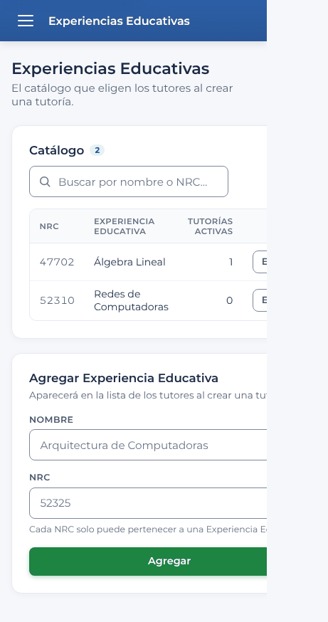
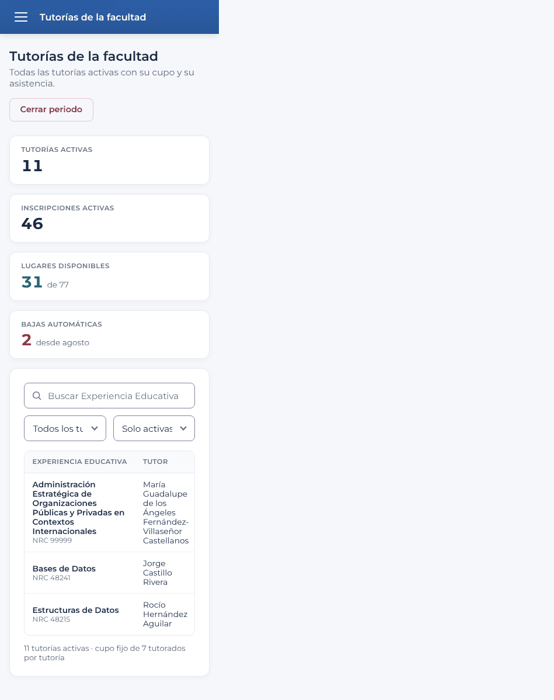
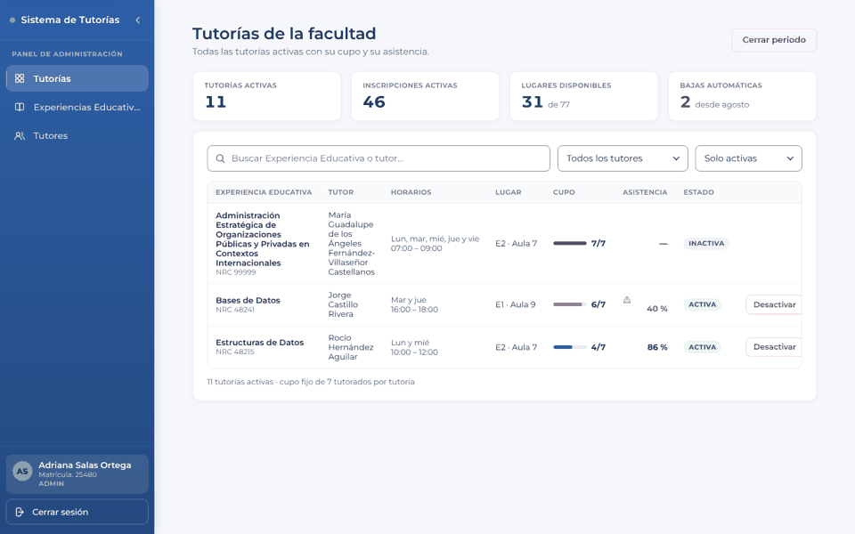
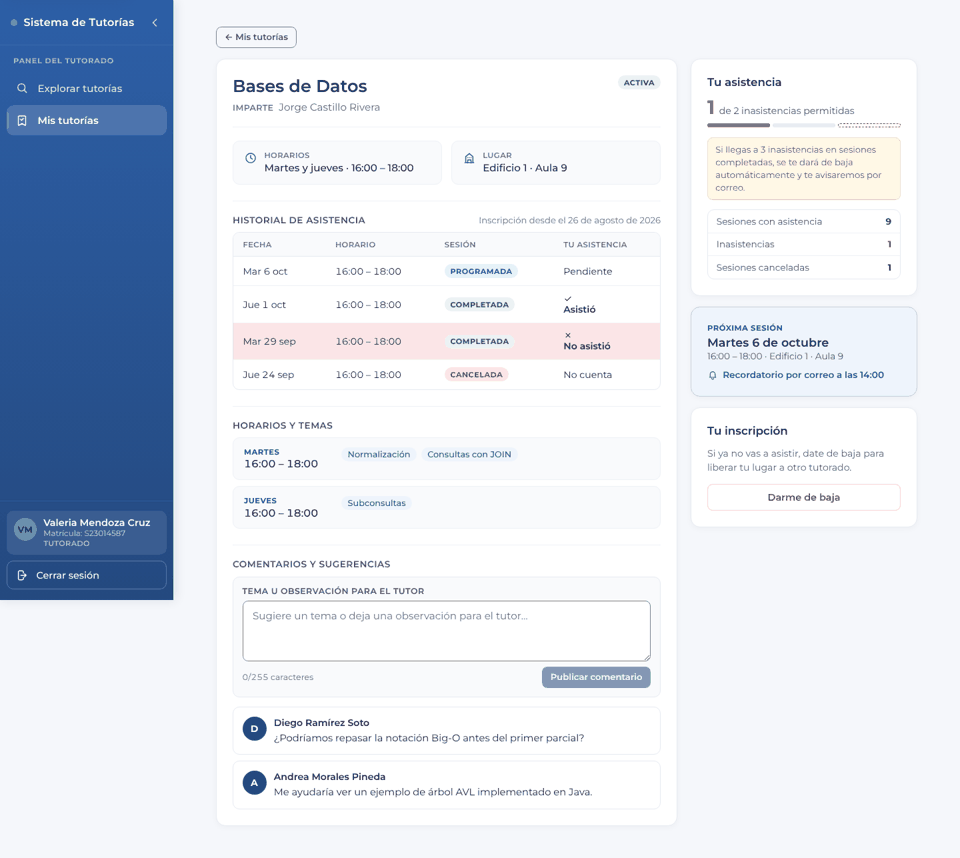
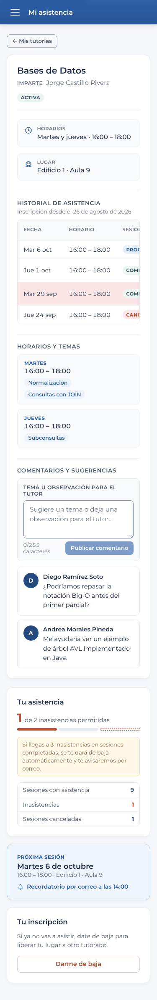
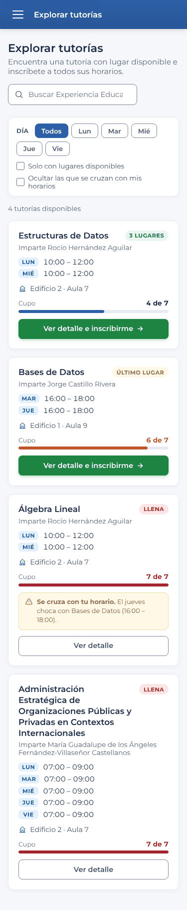
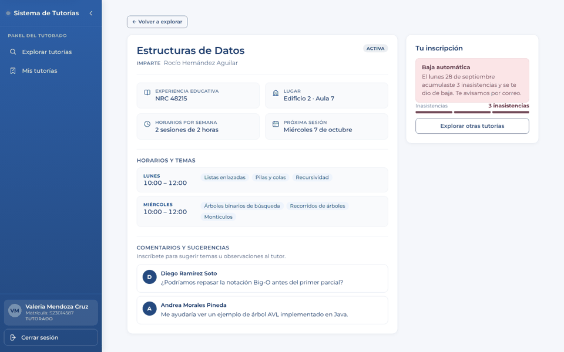

# Reporte de pruebas antes de la prueba con usuarios

Fecha: 20 de octubre de 2026 · Rama: `main` (commit `72698fe`) · Alcance: todo el frontend.

## Resumen

La app está en buen estado para la prueba de mañana: lint, formato, build y las 236 pruebas
automáticas pasan, no hay vulnerabilidades en las dependencias que llegan al navegador y los
flujos de los tres roles funcionan. Los problemas que encontré son casi todos **visuales en
móvil y tablet**, y los tres más graves se arreglan con una o dos líneas de CSS cada uno.

Antes de la prueba conviene corregir, en este orden:

1. **Experiencias Educativas y Tutores (admin) se salen de la pantalla en móvil y tablet**
   (V1). Los botones Editar y Quitar y los campos del formulario quedan cortados.
2. **La página se mueve de lado en Tutorías de la facultad y en Historial de asistencia**
   (V2) en tablet y móvil.
3. **Despertar el backend antes de empezar** (O1): si Render lo tiene dormido, las primeras
   peticiones pasan de los 15 s que espera el front y los usuarios verán "El servidor tardó
   demasiado en responder".

| Severidad | Visuales | Funcionales | Seguridad | Operación |
| --------- | -------- | ----------- | --------- | --------- |
| Alta      | 2        | 0           | 0         | 1         |
| Media     | 6        | 1           | 3         | 1         |
| Baja      | 7        | 2           | 4         | 0         |

## Cómo se probó

| Prueba                 | Resultado                                                                    |
| ---------------------- | ---------------------------------------------------------------------------- |
| `npm run lint`         | 0 errores, 0 avisos                                                          |
| `npm run format:check` | Todo formateado                                                              |
| `npm run test:run`     | 23 archivos, **236 pruebas, todas pasan**                                    |
| `npm run build`        | OK, sin avisos (bundle principal 414 kB, 130 kB gzip)                        |
| `npm audit --omit=dev` | **0 vulnerabilidades** en producción                                         |
| `npm audit` (todo)     | 6 en herramientas de desarrollo (no llegan al bundle), ver S7                |
| Recorrido en navegador | 22 pantallas x 3 tamaños (1440, 768 y 375 px) = 66 capturas                  |
| Pruebas de interacción | 46 acciones: login, registro, inscripción, comentarios, pase de lista, admin |
| Pruebas de seguridad   | XSS en comentarios, guardas por rol, token forjado, token vencido            |

El backend desplegado (`tutoriasbe.onrender.com`) no era accesible desde el entorno de
pruebas, así que el recorrido usó el build de producción (`vite preview`, con las mismas
cabeceras de seguridad que Render) contra un backend simulado con los datos de
`src/test/fixtures.js`, más casos con textos muy largos para forzar desbordes. Lo que depende
del backend real está en la [lista para mañana](#lista-de-verificacion-para-mañana).

---

## Bugs visuales

### V1. Alta: Experiencias Educativas y Tutores se salen de la pantalla en móvil y tablet

Debajo de 900 px las dos tarjetas (catálogo y formulario) miden 445 px en una pantalla de
375 px. Se cortan el botón **Editar**, el botón **Quitar**, la descripción y los campos del
formulario.

- **Causa:** `src/features/admin/pages/catalogo.module.css`, en `@media (max-width: 900px)`,
  usa `grid-template-columns: 1fr`. `1fr` no deja que la columna sea más angosta que su
  contenido (la tabla).
- **Corrección:** `grid-template-columns: minmax(0, 1fr);` (igual que en escritorio).
  Comprobado en el navegador: el ancho baja de 461 a 375 px
  ([captura con la corrección](reporte-pruebas/09-experiencias-movil-con-correccion.png)). La
  columna de acciones queda dentro del scroll de la tabla; ver V5.

### V2. Alta: la página entera se desplaza de lado en Tutorías de la facultad e Historial

| Pantalla                         | Ancho de la página | Pantalla |
| -------------------------------- | ------------------ | -------- |
| Tutorías de la facultad (tablet) | 957 px             | 768 px   |
| Tutorías de la facultad (móvil)  | 949 px             | 375 px   |
| Historial de asistencia (móvil)  | 442 px             | 375 px   |

`html { overflow-x: hidden }` lo oculta en Chrome de escritorio, pero en Safari de iOS la
página "baila" de lado al hacer scroll y en las capturas aparece una franja vacía a la
derecha.

- **Causa:** los textos solo para lectores de pantalla (clase `.oculto`, `position: absolute`)
  están dentro de las celdas de tablas con scroll. Como el contenedor de la tabla no está
  posicionado, esos textos se ubican respecto a la página y la ensanchan.
- **Corrección:** agregar `position: relative;` a `.tablaContenedor` en
  `src/features/admin/pages/TutoriasFacultad.module.css` y a `.contenedor` en
  `src/features/tutor/components/MatrizAsistencia.module.css`. Comprobado: los tres casos
  quedan exactamente al ancho de la pantalla.

### V3. Media: en escritorio la columna de acciones de Tutorías de la facultad queda cortada

A 1440 px el botón **Desactivar** queda pegado al borde y cortado; hay que hacer scroll dentro
de la tabla para verlo. Las columnas son angostas: un nombre de tutor largo ocupa 7 renglones.

- **Sugerencia:** dar a la columna Tutor un ancho mínimo (`min-width: 10rem`), juntar Lugar y
  Cupo, o mover Desactivar a un menú. Revisar con el nombre de EE más largo del catálogo real.

### V4. Media: los íconos de las celdas se apilan encima del texto

En **Mi asistencia** la palomita de "Asistió" y la cruz de "No asistió" quedan arriba del
texto, no a su lado. Lo mismo con el triángulo de "asistencia baja" en Tutorías de la facultad
(el "40 %" baja un renglón).

- **Causa:** `src/styles/global.css` define `svg { display: block }`.
- **Corrección:** `display: inline-block;` en `.asistio svg, .falto svg`
  (`MiAsistencia.module.css`) y una regla `.asistencia svg { display: inline-block; vertical-align: -2px; margin-right: 0.25rem; }`
  en `TutoriasFacultad.module.css`.

### V5. Media: en móvil las tablas esconden las columnas importantes sin avisar

- **Mi asistencia:** se ven Fecha, Horario y medio estado; la columna **Tu asistencia**, la que
  más le importa al tutorado, queda fuera de la pantalla.
- **Tutorías de la facultad:** solo se ven EE y Tutor; cupo, asistencia, estado y Desactivar
  quedan a la derecha.
- **Experiencias y Tutores:** Editar y Quitar quedan a la derecha (después de corregir V1).

No hay sombra ni flecha que indique que la tabla se desliza.

- **Sugerencia:** debajo de 600 px mostrar cada fila como tarjeta (etiqueta + valor), o al
  menos fijar la primera columna y agregar una sombra en el borde derecho. Como mínimo,
  quitar la columna Horario en Mi asistencia (es la misma en todas las filas).

### V6. Media: en Mi asistencia (móvil) el resumen queda al final de la página

En móvil la tarjeta **Tu asistencia** (inasistencias y aviso de baja) aparece después de los
comentarios, a más de 1.400 px de scroll. Sugerencia: en móvil mostrar la columna derecha
antes del historial (`order` en el grid).

### V7. Media: el buscador se corta y no ocupa el ancho en Explorar

- El texto de ejemplo dice "Buscar Experiencia Educa" en escritorio y en móvil (el campo es
  más angosto que el texto).
- En móvil el buscador mide 275 de 343 px disponibles.
- En Tutorías de la facultad (móvil) los selectores dicen "Todos los tu" y "Solo activas".

- **Sugerencia:** texto más corto ("Buscar EE o tutor") y `width: 100%` en el buscador debajo
  de 600 px; en admin, los selectores uno debajo del otro en móvil.

### V8. Media: botones y enlaces muy pequeños para el dedo (móvil)

Medidas a 375 px (lo recomendado es 44 px, mínimo 32):

| Control                                           | Tamaño   |
| ------------------------------------------------- | -------- |
| "×" para quitar un tema (detalle del tutor)       | 20 x 20  |
| "Historial de asistencia →"                       | 163 x 16 |
| "Ir al pase de lista" (aviso de listas abiertas)  | 126 x 21 |
| "Ver detalle →" (tarjetas del tutor)              | 301 x 22 |
| "Mostrar" (contraseña)                            | 82 x 25  |
| Chips de día en Explorar (Todos, Lun...)          | ~52 x 29 |
| "Crear cuenta" / "Iniciar sesión" (pie del login) | 95 x 18  |

El "×" de los temas es el más delicado: ver F1.

### V9. Baja: en el panel de baja automática la alerta queda pegada al medidor

En el detalle de una tutoría con baja automática, el medidor de inasistencias empieza justo
debajo de la alerta roja, sin espacio.

- **Corrección:** margen inferior en el `Alert` de ese caso (`PanelInscripcion.jsx`, caso
  `BAJA_AUTOMATICA`) o margen superior en `MedidorInasistencias`.

### V10. Baja: textos cortados en la barra lateral

- "Experiencias Educativ..." en el menú del admin (también cortado cuando está activo).
- "Rocío Hernández Agu..." en la tarjeta del usuario, sin `title` para ver el nombre completo.

Sugerencia: permitir dos renglones en los enlaces del menú o usar "Experiencias" a secas, y
agregar `title` al nombre.

### V11. Baja: otros detalles

- **Editar tutoría** usa el ícono de "Crear" (círculo con +).
- **Login y registro en móvil:** "Sistema de Tutorías" queda pegado al título de la cabecera
  azul ("Bienvenido de vuelta", "Crea tu cuenta"), sin espacio entre los dos.
- **Historial de asistencia en móvil:** los 4 indicadores van uno por renglón (600 px de
  scroll antes de la matriz); en 2 x 2 se ahorra la mitad. En escritorio el selector de
  tutoría no llega al borde derecho como el resto.
- **Textos de ejemplo realistas** ("Arquitectura de Computadoras", "52325", "S21008800") se
  pueden confundir con datos ya escritos. Sugerencia: "p. ej. Arquitectura de Computadoras".
- **Detalle del tutor:** la tarjeta "Comentarios de los tutorados" ocupa todo el ancho pero
  solo usa dos columnas; queda un hueco a la derecha.
- **Pantalla de edición en móvil:** el margen lateral es de 12 px y en las demás de 16 px.

---

## Bugs funcionales

### F1. Media: quitar un tema no pide confirmación ni se puede deshacer

En el detalle del tutor, tocar la "×" de un tema lo borra de inmediato (aviso "Tema
eliminado"). En móvil la "×" mide 20 x 20 px y está pegada al siguiente tema, así que es fácil
borrar uno por error. Las demás acciones destructivas (cancelar sesión, darse de baja, cerrar
lista, desactivar, cerrar periodo, quitar tutor, eliminar EE y comentario) sí piden
confirmación.

- **Sugerencia:** confirmar o, mejor, un aviso con botón "Deshacer" de 5 s; y agrandar la "×".

### F2. Baja: un id que no es número llega al backend

`/tutorado/tutorias/abc` (y las rutas equivalentes del tutor) piden `GET /tutorias/abc` y
muestran el mensaje del servidor tal cual. Con Spring Boot puede ser un 400 con un texto
técnico. Sugerencia: si el id no es un entero positivo, mostrar directamente "No encontramos
esta tutoría" sin llamar al backend.

### F3. Baja: un estado de panel desconocido no explica nada

Si `panelTutorado.estado` llega con un valor que el front no conoce, se muestra el panel de
"con lugar" con el botón Inscribirme deshabilitado y sin ninguna explicación. Sugerencia: un
aviso genérico ("No puedes inscribirte en este momento") y reportarlo a Sentry.

---

## Seguridad

Lo que se comprobó y está bien:

- **XSS:** un comentario con `<script>...` se muestra como texto;
  no se ejecutó nada. No hay `dangerouslySetInnerHTML`, `innerHTML` ni `eval` en el código.
- **Guardas por rol:** un tutorado que abre `/tutor/home` o `/administracion/tutorias` vuelve
  a su inicio; con sesión, `/login` redirige al inicio del rol.
- **Sesión:** un token vencido se descarta al abrir la app y manda al login con aviso; el
  cierre de sesión borra el token y "atrás" no regresa a la página privada. Tras iniciar
  sesión se vuelve a la página que se pidió.
- **Cabeceras:** `X-Frame-Options: DENY`, `nosniff`, `Referrer-Policy` y `Permissions-Policy`.
- **Secretos:** no hay claves ni contraseñas reales en el repo ni en el historial de git;
  `.env.production` solo trae la URL pública.
- **Sentry** no envía datos del usuario, cabeceras (token) ni cuerpos de peticiones.
- **Dependencias de producción:** 0 vulnerabilidades.

Pendientes:

### S1. Media: la CSP está en modo Report-Only y no bloquea nada

`render.yaml` envía `Content-Security-Policy-Report-Only`. En el recorrido completo (tres
roles, todas las pantallas) **no hubo ninguna violación** en la consola, así que ya se podría
aplicar. Antes, abrir la app desplegada con la consola del navegador y recorrer los tres
roles; si no aparece nada, renombrar la cabecera a `Content-Security-Policy` en `render.yaml`
y en `vite.config.js`.

### S2. Media: el token vive en `localStorage`

Cualquier XSS (propio o de una dependencia) podría leerlo. Hoy está bien mitigado (S1, sin
HTML crudo, React escapa todo), pero la solución definitiva es la cookie `HttpOnly` que ya
está en los pendientes del backend (punto 8 de `PENDIENTES_BACKEND.md`).

### S3. Media: la interfaz confía en el rol del token sin verificar la firma

Con un token falso con `rol: ADMIN` en `localStorage`, el front muestra el menú y las
pantallas de administración. Es esperado (el front no puede verificar la firma); lo que
importa es que el backend responda **401** a ese token y **403** cuando el rol no
corresponde. Hay que confirmarlo contra el backend real (ver la lista de mañana).

### S4. Baja: falta `Strict-Transport-Security`

Agregar `Strict-Transport-Security: max-age=31536000; includeSubDomains` en `render.yaml`
para que el navegador nunca use HTTP.

### S5. Baja: cerrar sesión no invalida el token

El JWT sigue siendo válido hasta su `exp` aunque el usuario salga. En una computadora
compartida del centro de cómputo no es un problema mientras el token no se copie, pero
conviene confirmar cuánto dura el token (`exp`) y que no sea de días.

### S6. Baja: el registro no confirma el correo

Cualquiera puede crear una cuenta de tutorado con una matrícula ajena (punto 7 de
`PENDIENTES_BACKEND.md`). Para la prueba de mañana basta con saberlo.

### S7. Baja: vulnerabilidades en herramientas de desarrollo

`npm audit` marca 6 (2 críticas en `seroval`/`solid-js`, que vienen de
`@tanstack/react-query-devtools`; `brace-expansion`, `browserslist`, `baseline-browser-mapping`
y `@babel/core`). Ninguna llega al bundle de producción. Se resuelven con `npm audit fix`.

### S8. Baja: la caché de datos sigue en memoria después de cerrar sesión

Al salir no se vacía la caché de React Query; se vacía cuando entra otro usuario, antes de
mostrar nada. No se ve en pantalla, pero llamar a `queryClient.clear()` en `logout` lo cierra
del todo.

---

## Operación

### O1. Alta: el backend en Render puede estar dormido

Si el backend está en el plan gratuito de Render, se apaga tras 15 minutos sin uso y tarda
30 a 60 s en despertar. El front corta cada petición a los 15 s (`TIMEOUT_MS` en
`src/api/client.js`), así que el primer login del día fallaría con "El servidor tardó
demasiado en responder".

- **Mañana:** abrir `https://tutoriasbe.onrender.com/v3/api-docs` 5 minutos antes de empezar
  y mantener a alguien usando la app.
- **Después:** plan con instancia siempre encendida, o un reintento automático del login con
  un mensaje "Despertando el servidor...".

### O2. Media: los correos dependen del backend

La app promete correos de confirmación, recordatorios 2 horas antes, avisos de cancelación y
de baja automática. No se pueden probar desde el front: revisar en la prueba que lleguen y no
caigan en spam.

---

## Lista de verificación para mañana

Lo que no se pudo probar sin el backend real:

- [ ] Despertar el backend antes de empezar (O1).
- [ ] Login con matrícula, con correo (en mayúsculas y minúsculas) y con número de personal.
- [ ] Registro de tutorado; registro de tutor autorizado y no autorizado.
- [ ] Inscripción con lugar, tutoría llena, choque de horario y baja voluntaria.
- [ ] Pase de lista completo: abrir, marcar, cerrar y comprobar la baja automática.
- [ ] Que lleguen los correos (O2).
- [ ] Con las herramientas del navegador, cambiar el token por uno inventado: el backend debe
      responder 401 y la app mandar al login (S3).
- [ ] Un tutorado llamando a `/admin/tutorias` con su token: debe ser 403.
- [ ] Consola del navegador sin avisos de CSP en los tres roles (S1).
- [ ] Probar en un iPhone real (Safari) Tutorías de la facultad e Historial (V2).
- [ ] Dos personas inscribiéndose al último lugar al mismo tiempo: solo una debe quedar.

## Lo que funcionó bien

- Las validaciones de los formularios (login, registro, crear tutoría, EE, tutores) muestran
  el error bajo cada campo, incluidos los que manda el backend (NRC duplicado, tutor no
  autorizado).
- Las horas se validan (la hora de fin debe ser posterior a la de inicio).
- Los diálogos de confirmación explican la consecuencia y se cierran con Escape.
- El menú lateral se recuerda, y en móvil el menú hamburguesa abre y cierra bien.
- Las fechas se calculan en la zona de México, sin desfases por la zona del navegador.
- Los filtros de Explorar se guardan en la URL y sobreviven a volver del detalle.
